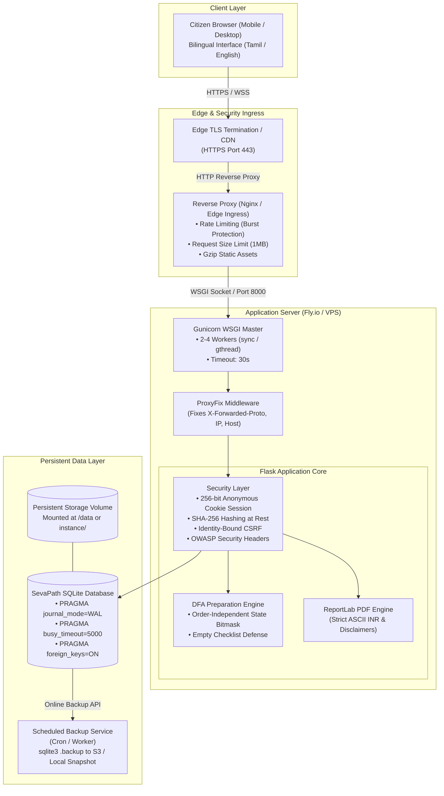

# SevaPath Phase 5: Production Readiness & Architecture Assessment

**Project:** SevaPath — Tamil Nadu Citizen Preparation Platform  
**Repository Baseline Commit:** `a7f25e6939e6a00508ea162540f269a3b6838a6f`  
**Branch:** `main`  
**Assessment Date:** 20 November 2026  
**Status:** Architecture Assessment Completed (Planning Stage — No Production Changes Implemented)

---

## 1. Executive Summary & Project Baseline

SevaPath is a bilingual (Tamil and English) citizen preparation web platform designed to assist applicants in organizing documentation requirements for Tamil Nadu civic services prior to visiting e-Sevai centres or applying online.

### Supported Services
1. **Community Certificate (REV-101)** — Revenue Administration & BC/MBC Welfare Department
2. **Nativity Certificate (REV-102)** — Revenue Administration Department
3. **Income Certificate (REV-103)** — Revenue Administration Department

### Completed Project Milestones
* **Phase 1:** Flask application foundation, SQLite database schema, bilingual service catalog, and Bootstrap 5 responsive layout.
* **Phase 2:** Deterministic Finite Automaton (DFA) preparation engine ($Q, \Sigma, \delta, q_0, F$), order-independent state transitions, and interactive SVG visualization.
* **Phase 3:** Independent regex input validation engine (phone, email normalization), session security hardening, and strict CSRF header verification (`X-CSRF-Token`).
* **Phase 4:** Anonymous citizen cookie sessions (`sevapath_sid`), SHA-256 hashed storage at rest, race-safe compare-and-swap (CAS) token rotation, citizen-bound CSRF, dynamic readiness target masks ($M_{\text{session}}$), empty-checklist protection, ReportLab PDF generation, browser print view, and 130 passing automated tests.

---

## 2. Production Configuration Audit

### Verified Existing Safeguards
* **Mandatory Production `SECRET_KEY` Enforcement:** In `app/__init__.py`, initializing with `config_name == "production"` validates that `SECRET_KEY` is present in the environment and differs from the development fallback. If missing or default, application startup fails safely with a fatal `RuntimeError`.
* **Strict HTTPS Cookie Enforcement:** In `config.py`, `ProductionConfig` enforces `SESSION_COOKIE_SECURE = True`, restricting cookies to encrypted TLS connections.
* **Debug Mode Disabled:** `ProductionConfig.DEBUG = False` prevents Flask's interactive debugger console from running in production.
* **Isolated Testing Environment:** `TestingConfig` uses dedicated test databases, and test fixtures dynamically allocate temporary databases (`tempfile.mkstemp`) that are removed after test runs.

### Missing Safeguards & Deficiencies
* **Insecure Default Environment in `run.py`:** `run.py` defaults to `os.environ.get("FLASK_ENV", "development")`. In Flask 3.x, `FLASK_ENV` is deprecated. If booted without explicit environment variables, the server runs under `DevelopmentConfig` with an insecure hardcoded secret key and insecure cookie flags.
* **Absence of `ProxyFix` Reverse Proxy Middleware:** `create_app()` does not wrap `app.wsgi_app` with Werkzeug's `ProxyFix`. Behind cloud reverse proxies or load balancers, `request.is_secure` defaults to `False`, external links generate `http://` instead of `https://`, and client IPs reflect proxy IPs.
* **Missing Production WSGI Server:** `run.py` invokes Flask's single-threaded development server (`app.run()`). No dedicated WSGI entry point (`wsgi.py`) or Gunicorn configuration is present.
* **Unbounded HTTP Request Body Size:** Neither `Config` nor `ProductionConfig` defines `MAX_CONTENT_LENGTH`, exposing workers to memory exhaustion from oversized HTTP payloads.
* **Missing Global HTTP Security Headers:** Web responses lack standard defensive headers (`Strict-Transport-Security`, `X-Frame-Options`, `Content-Security-Policy`, `Referrer-Policy`).

---

## 3. Database Production Readiness

### SQLite Suitability Analysis
SevaPath's citizen preparation workflow features low write frequency (~5 to 10 checkbox updates per preparation session over several minutes) and stores minimal anonymous data (token hash and item completion status, $< 2\text{ KB}$ per session). 

**Verdict:** SQLite is **architecturally sufficient and optimal for initial production workloads** (hundreds of concurrent users and tens of thousands of preparation sessions), avoiding external database networking latency and credential management overhead, provided Write-Ahead Logging (WAL) and persistent storage are configured.

### Concurrency & Locking Risks
* **Default Rollback Journal:** Database connections currently default to standard rollback journal mode (`DELETE`). In multi-worker WSGI deployments, any active write transaction acquires an exclusive lock that blocks all readers, and active readers block writers.
* **Missing Busy Timeout:** Connections in `get_db()` do not configure a busy timeout or `PRAGMA busy_timeout = 5000;`. Concurrent writes under load will immediately raise `sqlite3.OperationalError: database is locked`.

### Storage Persistence Risks
* `DATABASE_PATH` defaults to `instance/sevapath.sqlite`.
* Container platforms (Render, Railway, Fly.io, Docker) use ephemeral root filesystems by default. Deploying without an attached, mounted **Persistent Volume** causes total data loss on every deploy, restart, or automated scaling event.

### Backup and Disaster Recovery Gaps
* Live copying (`cp`) of an active SQLite database during writes risks page corruption.
* The repository lacks an online backup mechanism (such as SQLite's `VACUUM INTO` or the `sqlite3.Connection.backup()` API) and has no documented or tested restoration runbook.

---

## 4. Security Findings Matrix

| Finding ID | Severity | Description | Verified Evidence | Recommended Production Correction |
| :--- | :--- | :--- | :--- | :--- |
| **SEC-01** | **CRITICAL** | Insecure Environment Default Fallback | `run.py` line 9 | Enforce explicit `APP_ENV=production` and refuse application startup if unset or invalid. |
| **SEC-02** | **HIGH** | Missing `ProxyFix` Middleware | `app/__init__.py` | Wrap WSGI app with `werkzeug.middleware.proxy_fix.ProxyFix` to correctly parse `X-Forwarded-Proto`, `X-Forwarded-For`, and `X-Forwarded-Host`. |
| **SEC-03** | **HIGH** | Unthrottled Resource-Intensive Endpoints | `app/routes/reports.py` and `app/routes/api.py` | Add rate limiting to `/service/<slug>/download-pdf` (CPU/memory protection) and `/api/citizen/session` (database inflation defense). |
| **SEC-04** | **MEDIUM** | Missing Global HTTP Security Headers | `app/__init__.py` | Implement an `@app.after_request` hook providing HSTS, `X-Frame-Options: DENY`, `X-Content-Type-Options: nosniff`, and Content-Security-Policy. |
| **SEC-05** | **MEDIUM** | Unbounded Request Payload Limits | `config.py` | Set `MAX_CONTENT_LENGTH = 1048576` (1 MB) across configurations to prevent denial-of-service via large request bodies. |
| **SEC-06** | **MEDIUM** | Shallow Health Check Probe | `app/routes/main.py` line 125 | Enhance `/health` to execute `SELECT 1;` against SQLite so orchestration probes detect database failures. |
| **SEC-07** | **LOW** | Production Dependency Hygiene | `requirements.txt` | Remove test runners (`pytest`) from runtime dependencies; pin exact package versions; create `requirements-dev.txt`. |
| **SEC-08** | **INFORMATIONAL** | Anonymous Session Expiration Inactivity Window | `app/core/security.py` | 14-day inactivity expiration is intentional for citizen privacy. Data recovery after expiration is impossible by design; advisory banner communicates this to users. |

---

## 5. Hosting Platform Evaluation

*Note: Platform features, allowances, and pricing structures vary over time and must be reverified against current vendor documentation prior to provisioning.*

| Hosting Option | Flask WSGI Support | Persistent SQLite Storage | TLS / HTTPS | Deployment Complexity | Backup Support | Architectural Suitability |
| :--- | :--- | :--- | :--- | :--- | :--- | :--- |
| **Fly.io** | Native Docker / Procfile | Available via dedicated NVMe Volumes mounted at `/data` | Automatic Edge TLS | Low to Medium | Volume snapshot support | **Highly Recommended** (Best cloud choice for persistent SQLite) |
| **Self-Hosted VPS** (Ubuntu / Debian + Nginx + Gunicorn) | Full Control | Available via native host filesystem | Free Let's Encrypt via Certbot | Medium to High | Automated cron jobs via SQLite online backup API to S3/R2 | **Highly Recommended** (Maximum operational control and reliability) |
| **Railway** | Supported via Docker / Nixpacks | Available via Railway Persistent Volumes | Automatic Edge TLS | Low | Volume snapshot / manual backup | **Recommended** (Viable container alternative) |
| **Render** | Native Python Runtime | Only available on paid instances (Render Disks) | Automatic Edge TLS | Low | Manual disk snapshot | **Not Recommended on Free Tier** (Ephemeral disk resets database on deploy) |

---

## 6. Proposed Production Deployment Architecture

---

## 7. Phase 5 Implementation Roadmap

### Phase 5.1: Production Configuration, WSGI Entry Point & Startup Hardening
* **Scope:** Create `wsgi.py` production entry point; add `gunicorn` to `requirements.txt`; configure `MAX_CONTENT_LENGTH = 1048576`; register `ProxyFix`; prevent insecure development fallbacks in production.
* **Testing:** Validate WSGI entry point, proxy header rewriting, and HTTP 413 payload limits.

### Phase 5.2: SQLite WAL Optimization, Persistence & Automated Backups
* **Scope:** Configure `PRAGMA journal_mode = WAL;`, `PRAGMA busy_timeout = 5000;`, and `PRAGMA synchronous = NORMAL;` on connection creation; implement deep `/health` database check; create online backup and restoration scripts (`scripts/backup_db.py`, `scripts/restore_db.py`).
* **Testing:** Multi-threaded concurrent write tests; backup generation and recovery verification.

### Phase 5.3: HTTP Security Headers, Rate Limiting & Operational Logging
* **Scope:** Implement security header hooks (HSTS, CSP, X-Frame-Options, Referrer-Policy); implement rate limiting on PDF and session endpoints; configure structured production logging without sensitive data.
* **Testing:** Header compliance tests and rate-limiting exhaustion tests (HTTP 429).

### Phase 5.4: Containerization & Infrastructure Specification
* **Scope:** Create production multi-stage, non-root `Dockerfile`; define `fly.toml` or Nginx/systemd configuration with persistent volume mounts; author operational runbook.
* **Testing:** Non-root container execution smoke tests.

### Phase 5.5: Staging Verification, Load Testing & Production Release
* **Scope:** Deploy to staging environment; execute end-to-end smoke tests; run concurrent citizen load test (100 simultaneous sessions); verify mobile layout and reports.
* **Testing:** Full end-to-end staging validation.

---

## 8. Current Production Readiness Verdict

**Verdict:** **NOT YET PRODUCTION-READY (Pending Phase 5 Implementation)**

While application logic, bilingual catalog content, DFA state transitions, CSRF protection, and report generation are thoroughly verified with 130 passing tests, public production release requires resolving the production WSGI server setup, SQLite WAL concurrency, persistent storage mounting, reverse proxy headers, and rate limiting.

### Documented Known Limitations
1. **Anonymous Expiration Recovery:** Because SevaPath stores zero citizen PII or credentials, preparation progress cannot be recovered once an anonymous session expires after 14 days of inactivity or when browser cookies are cleared. This is an intentional privacy architecture feature communicated via the bilingual advisory banner.
2. **PDF Typography:** The offline PDF report uses standard ReportLab fonts (`Helvetica`) and English text with ASCII currency (`INR 60`). Tamil language preparation reporting is delivered via the high-contrast browser print view (`/service/<slug>/print`).
